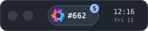
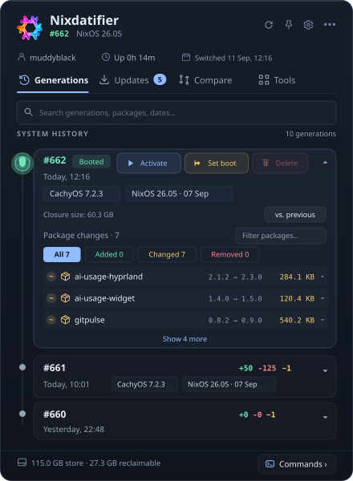
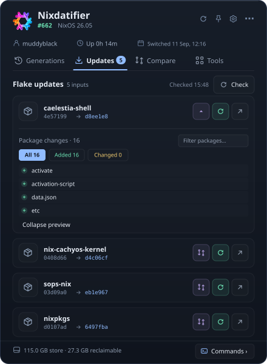
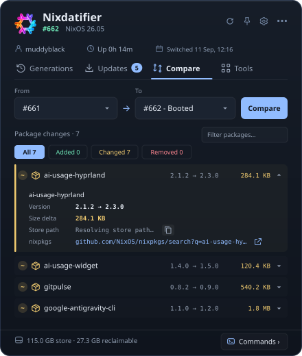
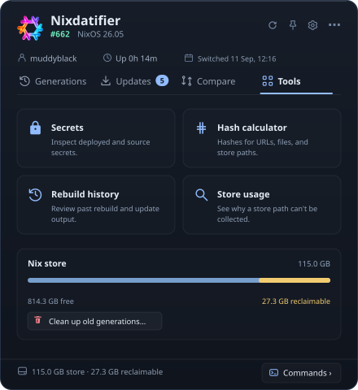
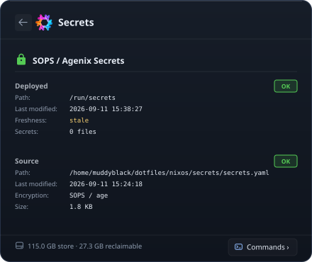
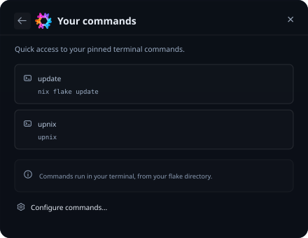

<p align="center">
  
</p>

<h1 align="center">Nixdatifier</h1>

<p align="center">
  <a href="https://store.kde.org/p/2360222/">
    
  </a>
  
  
  <a href="https://opensource.org/licenses/MIT">
    
  </a>
  <a href="https://store.kde.org/p/2360222/">
    
  </a>
  <a href="https://github.com/Muddyblack/nixdatifier/releases">
    
  </a>
  
</p>

<p align="center">
  
</p>

<p align="center">
  System generations, package diffs, flake updates, secrets, dev environments, and Nix store usage, from a tray icon on any Linux desktop. Also available as a KDE Plasma 6 widget and a Quickshell panel.
</p>

## A closer look

<p align="center">
  <a href="https://www.youtube.com/shorts/sPLJVrwA7G4">
    
  </a>
  <br>
  <a href="https://www.youtube.com/shorts/sPLJVrwA7G4"><strong>▶ Watch on YouTube Shorts</strong></a>
</p>

| Generations timeline | Flake updates |
| --- | --- |
|  |  |
| Booted and next-boot generations on one rail, with per-generation package counts and inline actions. | Pending upstream inputs, revision changes, and package previews before you update. |

| Compare generations | Tools & Nix store |
| --- | --- |
|  |  |
| Package additions, removals, and upgrades between any two generations. | Store size, reclaimable space, cleanup, and the built-in tools. |

| Secrets inspector | Custom commands |
| --- | --- |
|  |  |
| Deployed and encrypted source secrets for sops-nix and agenix. | Your own terminal commands, run from the flake directory. |

---

## Highlights

- **Generations** — timeline with booted and next-boot markers, package changes, activate, set-boot, delete.
- **Compare** — diff any two generations; see the `.nix` changes behind each one.
- **Flake updates** — check inputs upstream, preview the package changes, update one input.
- **Tools** — secrets inspector, hash calculator, rebuild history, store usage, and cleanup.
- **Dev environments** — direnv state, `devShells`, and stale inputs for any project folder.
- **System health** — pending reboot, full `/boot`, end-of-life release, slow caches, failed units.
- **Persistent folders tab** — On impermanence setups, see what survives a reboot and clean up leftovers.
- **Any desktop** — standalone app with tray icon, Plasma 6 widget, or Quickshell panel.

Full list in [docs/features.md](docs/features.md).

## Quick start

```bash
nix run github:Muddyblack/nixdatifier   # try it without installing
nixdatifier --autostart                 # start in the tray at login
```

NixOS module, Home Manager, KDE Store, and manual installs are in [docs/install.md](docs/install.md).

## Documentation

| | |
|---|---|
| [Install](docs/install.md) | Nix, NixOS, Home Manager, KDE Store, requirements |
| [Command line](docs/cli.md) | `nixdatifier generations`, `updates`, `gc`, … with text, TSV and JSON output |
| [Hosts](docs/hosts.md) | Standalone app, Plasma widget, Quickshell panel, tray and CLI flags |
| [Configuration](docs/configuration.md) | Every setting and its default |
| [Features](docs/features.md) | What each tab does |
| [Architecture](docs/architecture.md) | How it works and what it costs while idle |
| [Contributing](CONTRIBUTING.md) | Development setup, tests, guidelines |
| [Security](SECURITY.md) | Reporting vulnerabilities |

## Support

If Nixdatifier saves you time, you can support its development:

[](https://github.com/sponsors/muddyblack)
[](https://ko-fi.com/muddyblack)
[](https://buymeacoffee.com/muddyblack)

Stars, bug reports, and translations help just as much.

## License

[MIT](LICENSE)
