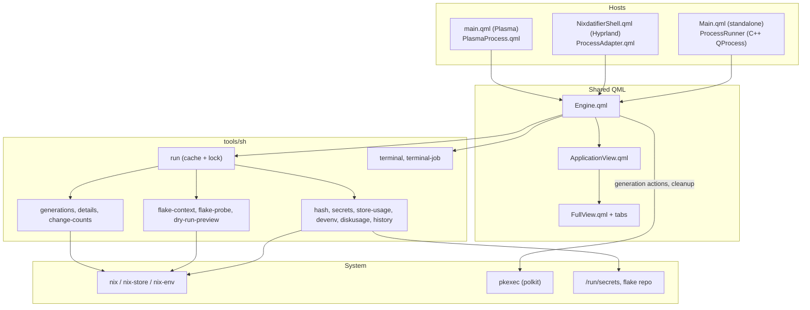

# How it works

The QML engine runs small helper scripts from `package/contents/tools/sh/` and parses their output. Each host supplies its own process runner. Expensive reads go through `run cached`, a result cache shared by every widget instance. System changes go through `run mutate`, a lock that prevents two operations from running at once.

## Idle cost

The widget does as little as possible while you are not looking at it:

- **Settings do not poll while idle.** Info wakes only for a pending request timeout, retry, or refresh cooldown. Once loaded, its timer stops. Closing settings destroys the Info pane, aborts its requests, and releases their callbacks.
- **Tray animation reuses artwork.** The Quickshell tray helper rasterizes the SVG once and caches at most 60 smoothly rotated frames. It releases the animation frames when idle and ignores duplicate status updates.
- **Package previews have a deadline.** A stalled download, evaluation, or cache-lock wait ends after three minutes with a retryable error instead of leaving the loading indicator running indefinitely.
- **No expensive background timers.** Store summaries query the GC graph and NAR size metadata in parallel at low priority, without walking every store inode. Logical totals and estimated GC candidates use the same units; actual freed disk space can differ because of shared files, compression, and snapshots. A shared cache lasts up to 30 minutes; observed store/profile changes permit a refresh after five minutes, and explicit refreshes bypass that delay. Cached summaries refresh free space with a cheap `df` call. Work requested after the popup closes waits for the next open. Nix metadata queries have two-minute deadlines, and store cache-lock waits are bounded.
- **Refreshes survive concurrent work.** Repeated UI requests coalesce. A forced refresh during a probe discards that older snapshot and schedules one fresh probe. Cache file identities let simultaneous forced callers share new results without reusing an earlier same-second result. Mutation epochs keep in-flight old snapshots from repopulating the current cache; failed measurements do not overwrite valid UI values.
- **Folder work is bounded.** The in-memory listing cache retains at most 300 directory snapshots. Folder rows render in batches of 60, and queued/deleting status changes do not rebuild the list model. Deleting persistent content invalidates shared folder snapshots.
- **Animations stop when the popup closes.** Every looping animation is tied to whether the popup is on screen, so a closed popup does not keep the render loop awake.
- **The flake cache watch cannot spin.** Cross-instance sync waits on `inotifywait`. If that is missing or unusable, the widget falls back to a slow poll instead of respawning the watch in a tight loop.
- **Package lookups are bounded.** Homepage lookups are batched into one evaluation. The `/nix/store` fallback scan is a single pass and is skipped for large diffs.

While closed, a configured widget runs one `flake-probe` per check interval (hourly by default, shared between instances) and one cheap `sysinfo` read every 30 minutes.
